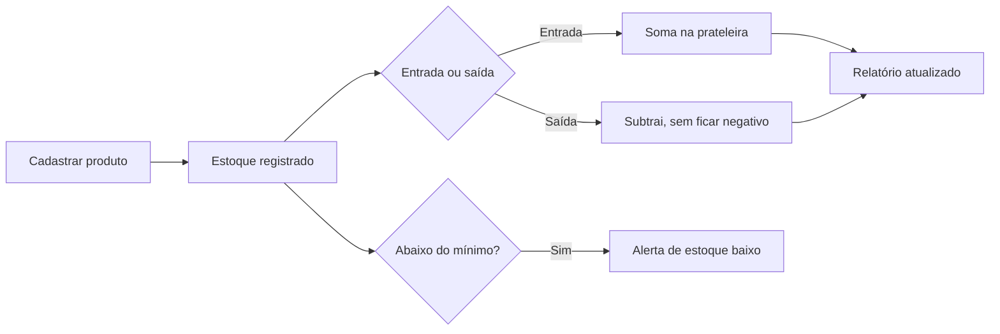

# Atrás do Balcão

> Controle de estoque para quem tem loja e não tem tempo para caderno, planilha ou calculadora.

---

## A ideia em uma frase

**O Atrás do Balcão junta, no próprio celular, o que a loja tem na prateleira e quanto dinheiro foi investido nela.**

Muita loja pequena controla o estoque de cabeça, num papel qualquer ou só quando alguma coisa acaba. O resultado é conhecido: vende-se um produto que não existe mais, compra-se duplicado, ou descobre-se no fim do mês que o dinheiro sumiu em mercadoria parada. O app existe para que o lojista saiba o que tem, o que está acabando e quanto investiu, em poucos toques.

## Para quem é

| Quem usa | Como usa | O que ganha |
| :--- | :--- | :--- |
| **Lojista de bairro** | Todo dia, no balcão, entre um cliente e outro | Sabe o que repor sem precisar contar tudo |
| **Dono de pequeno comércio** | Na hora de comprar mercadoria | Vê o que está em falta e o que já está parado |
| **Quem toca a loja sozinho** | Com o celular na mão | Tem um controle simples, sem sistema caro e sem internet |

A pergunta que o app responde é simples: **"o que eu tenho, o que está acabando e quanto eu já investi?"**

## Como funciona

O fluxo é curto de propósito. Você cadastra o produto uma vez, depois só registra o que entrou e o que saiu. Todo o resto (alerta, relatório e busca) acontece sozinho.

## O que dá para fazer

- **Cadastrar** produtos com nome, categoria, quantidade, quantidade mínima e preço de custo.
- **Editar** ou **remover** um produto quando algo mudar ou quando ele sair de linha.
- **Dar entrada e saída** de mercadoria. A saída nunca deixa o estoque no negativo.
- **Ver o alerta** de estoque baixo, sempre que a quantidade chegar ao mínimo.
- **Buscar** pelo nome, ignorando acento, mesmo numa lista grande.
- **Acompanhar o relatório** com o total investido no estoque atual, produto por produto.

## Por que ele é diferente

1. **Simples de propósito.** Uma tela principal, cadastro curto e nada escondido em menus.
2. **Funciona sem internet.** Tudo fica salvo no celular. Sem sinal, sem problema.
3. **Sem assinatura, sem nuvem.** Os dados são da loja e ficam com a loja.
4. **Pensado para o dia a dia.** Mensagens de erro em português claro, dizendo o que corrigir.

## O que ele não faz (por enquanto)

Esta versão cuida do estoque e do dinheiro investido em mercadoria. Ela **não** calcula lucro, margem ou preço de venda, não faz pagamentos e não sincroniza com nuvem. Quanto cobrar por cada produto continua sendo decisão do lojista.

---

## Equipe

O projeto foi feito pelo grupo **Kaigang**, da turma 3º ano B. Cada integrante responde pela sua parte e precisa saber explicá-la.

| Integrante | Área | Responsabilidade |
| :--- | :--- | :--- |
| **Ian** | Telas | Interface, navegação e a forma como as informações aparecem na tela |
| **Heitor** | Dados | Banco de dados, repositórios e segurança do acesso |
| **Mariah** | Identidade visual | Nome, cores, ícone e recursos do app |
| **Pedro** | Build e entrega | Documentação, geração do app e preparação para a loja |

## Sobre o projeto

Atrás do Balcão é um trabalho final do grupo Kaigang, feito com apoio de ferramentas de IA sob regras combinadas pelo grupo. O histórico de quem fez o quê está registrado no repositório, na pasta `docs/`.
